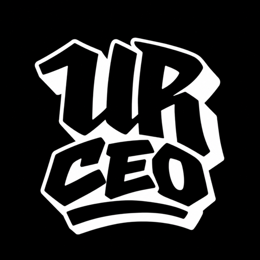

<p align="center">
  
</p>

<h1 align="center">FMS CEO</h1>
<p align="center"><b>Sé el CEO de la FMS.</b> Un manager de batallas de freestyle al estilo Football Manager.<br>
Juego de fans · gratuito · sin ánimo de lucro · funciona sin internet</p>

---

## 🎮 Descargar y jugar

### Windows
1. Ve a **[Releases](../../releases)** y descarga **`FMS_CEO.exe`**.
2. Haz doble clic. No hace falta instalar nada (la primera vez tarda unos segundos en abrirse).

> ⚠️ Como el juego no está firmado digitalmente, Windows puede mostrar *"Windows protegió su PC"*.
> Pulsa **"Más información" → "Ejecutar de todas formas"**.

### Navegador (Windows, Mac, Linux, móvil)
Descarga **`index.html`** y ábrelo con Chrome, Edge, Firefox o Safari. Funciona sin internet.

## 💾 Partidas
- La partida se guarda sola.
- Desde el juego puedes **exportar** la partida a un archivo e **importarla** en otro ordenador o navegador.
- En el ⚙️ (arriba a la derecha) puedes **reiniciar el juego** y **añadir tus propios competidores** (nombre, nacionalidad, foto y estilo).

## 🏆 Qué incluye
- **Ligas nacionales**: España, Argentina, México, Chile, Perú, Colombia y Caribe, más la **FMS Internacional** y la **FMS World Series**.
- **Más de 340 freestylers** reales, cada uno con su nivel, fama, hype y estilo (Punchline, Ingenio, Métrico, Flow, Showman, Disonante, Teatral, Coherencia, Poético).
- **Jornadas en directo** con formato corto y largo (Easy, Hard, Temáticas, Random, Minutos, Deluxe), réplicas y PTB.
- **Red Bull Batalla** (nacionales, Torneo de Plazas e Internacional) y **competiciones Under** (Monster Fu, Cuna de Oro, General Rap, BDM…).
- **Gestión de la empresa**: estrellas, fichajes, salarios, patrocinadores, speakers/hosts, exhibiciones, calendario y visitas.
- **Eventos únicos**: rechazos, bajas, rivalidades, polémicas, edits de Ryker, streamers…
- **Twitter/X dentro del juego**: la comunidad reacciona a los line ups, a los cruces de cada jornada y a los campeones, con más de 130 tuiteros reales y su forma de hablar según el país.

## 🛠️ Compilar el .exe tú mismo (opcional)
Necesitas [Node.js](https://nodejs.org/) instalado.

```bash
npm install
npm start           # genera index.html y abre el juego en una ventana
npm run build:win   # genera index.html y dist/FMS_CEO.exe
```
> Compílalo desde Windows. En Linux/Mac, `electron-builder` necesita Wine para poner el icono al ejecutable.

## 📁 Archivos
| Archivo | Qué es |
|---|---|
| `index.html` | El juego completo (todo incluido en un solo archivo). **Se genera desde `src/`, no se edita a mano** |
| `src/` | Código fuente del juego, separado por partes (ver abajo) |
| `scripts/build.js` | Junta `src/` en `index.html` |
| `main.js` | Ventana de escritorio (Electron) |
| `package.json` | Configuración para compilar el `.exe` |
| `build/` | Icono del juego |
| `AVISO_LEGAL.md` | Aviso de juego de fans |

## 🧩 Código fuente
El juego se sigue repartiendo como un único `index.html`, pero se edita en `src/`:

```
src/
  index.html   plantilla: el esqueleto de la página y el orden en que se incluye todo
  css/         estilos, por secciones (01-fuentes.css … 16-x-y-speakers.css)
  js/          lógica del juego, por secciones (00-imagenes.js … 25-creador-y-ajustes.js)
  assets/      imágenes y fuentes como archivos normales
    faces/  logos/  speakers/  streamers/  tuiteros/  under/  emojis/  varios/  fonts/
```

- En la plantilla, `{{include:js/06-simulacion.js}}` mete ese archivo tal cual.
- En el CSS y el JS, `{{asset:faces/aczino.jpg}}` se convierte en la imagen incrustada (`data:image/jpeg;base64,…`).
- Los archivos de `js/` se juntan en un solo `<script>` y **el orden importa** (el número del nombre es su posición).
  Por eso `src/index.html` no se abre directamente: hay que generar el juego.

```bash
npm run build   # genera index.html desde src/ (solo necesita Node, sin npm install)
npm run check   # comprueba que index.html está al día con src/
```

## 🐛 Fallos y sugerencias
Escríbeme por X: **[@MedsterRM](https://x.com/MedsterRM)**. ¡Gracias por jugar!

## ⚖️ Aviso
Proyecto **hecho por fans, gratuito y sin ánimo de lucro**. No está afiliado a FMS, Urban Roosters, Red Bull ni a ninguna de las personas o marcas que aparecen. Todas las marcas e imágenes pertenecen a sus propietarios. Más detalles en [AVISO_LEGAL.md](AVISO_LEGAL.md).
